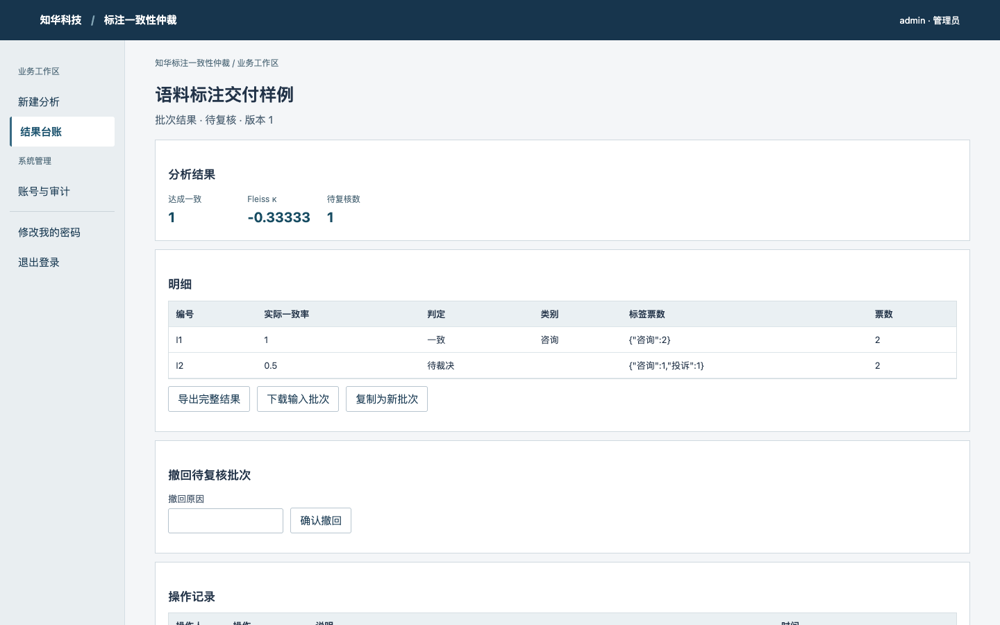

# ZhuaTech Label Council

[中文（默认）](README.md) · Independent enterprise AI workbench by Shanghai Rujing Zhihua Information Technology Co., Ltd. (上海如静知华信息科技有限公司).

Collect independent votes, identify ties and disagreements, and calculate Fleiss’ kappa when applicable. A different reviewer must choose an observed label for every unresolved item before releasing the adjudicated result.

## 1.3: business acceptance

Record and retain the original voting disposition: insufficient votes, tied leaders, below threshold or consensus. Previously saved results remain unchanged. Re-run a copy to apply the new calculation.

## 1.4: account operations

Admins can unlock another active account with a verification note. Unlocking revokes sessions, not the password. Concurrent changes recheck admin permissions, and audit history supports cursor pagination. After launch, run `python3 scripts/check-service.py --wait 60` for a read-only local readiness check.

## Run locally

Optional: run `python3 scripts/doctor.py` to check Java, the local bind address/port, and data directory permissions before launching. Python is not required to run the workbench.

**1.2 update:** JSON imports identify the offending row or field instead of silently dropping unknown columns. Authors may withdraw a pending batch with a reason, retain its input and result, and copy it for correction. Concurrent retries with the same submission key and payload resolve to a single record on MySQL.

A full JDK 21 is sufficient for a source build. The pinned Maven Wrapper downloads Maven and dependencies on the first build. Run `bash scripts/start.sh` (macOS/Linux) or `.\scripts\start.cmd` (Windows) in the project root. Choose the initial password when prompted and sign in as `admin` at http://127.0.0.1:19328. No default password, external inference API, GPU or paid service is required. A built JAR only requires Java 21. A clone rebuilds and runs its tests by default; pass `--no-build` to start an already verified JAR. The local H2 file survives restart; MySQL 8.4 is supported for deployments.

## Workflow and checks

An operator enters rows or imports [a batch](examples/batch.json), runs the calculation and inspects its evidence. A different reviewer approves or returns the immutable input snapshot. Viewers cannot change records. Admins manage accounts and inspect the audit trail. Repeated requests with the same key are safe. Use `./mvnw -f backend/pom.xml clean package` and `python3 scripts/smoke.py` to verify the built application and restart persistence. See [deployment and API notes](docs/OPERATIONS.md) for endpoint details and limits. This first version is designed for small batches; deployment-specific load, security and recovery acceptance is still required.

Version 1.1 adds literal title search, personal and pending-review queues, role changes from the admin console and password rotation. Changing your password revokes all existing sessions. A failed initial setup can be retried without deleting data.

## License and enterprise support

The [source-available license](LICENSE) permits personal non-commercial learning and exchange only. Commercial operation, customer delivery and internal production require separate written authorization. Not an OSI open-source license. Related upstream project: [HumanSignal/label-studio](https://github.com/HumanSignal/label-studio); this is an independent implementation, not an upstream distribution.

[English website](https://www.zhuatech.cn/en.html) · [han@zhuatech.cn](mailto:han@zhuatech.cn) · [jack@zhuatech.cn](mailto:jack@zhuatech.cn) · [WhatsApp +86 17521234993](https://wa.me/8617521234993)
